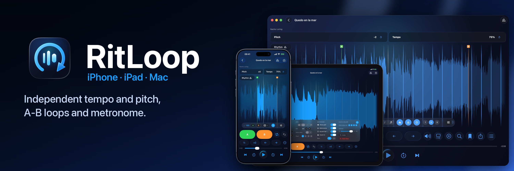

  

# Ignacio Ampurdanés

Software developer in Cádiz, Spain. Fifteen years as a professional jazz drummer before that, which is where the app below comes from.

## RitLoop

A native app for musicians who learn by ear. Independent tempo and pitch, a waveform you can scrub, A-B loops saved per song, and a beat grid with a metronome that stays on the song when you slow it down. iPhone, iPad and Mac, one codebase.

Submitted to App Review in September 2026. Built with Swift 6 (strict concurrency), SwiftUI, AVAudioEngine, Accelerate, SwiftData, StoreKit 2 and CloudKit. Localized in 13 languages. No backend.

The repo is private while the app is in review. Privacy and support pages: [ritloop.app/privacy](https://ritloop.app/privacy) · [ritloop.app/support](https://ritloop.app/support)

## Power Platform

Four-month internship at Plexus Tech in 2026, on the Power Platform team. Three Canvas apps shipped with a teammate: shift and absence management with automatic shift proposals, corporate expenses with receipt capture and approval flows, and warehouse stock. Power Apps, Power Fx, Power Automate and SharePoint, without Premium connectors and working around SharePoint delegation limits as the lists grew.

## Open source

- [ClaudeCodeNotify](https://github.com/IARFLOW/ClaudeCodeNotify): macOS daemon that sends a system notification when Claude Code finishes or is waiting for input, and focuses the terminal on click.
- [demucs-mlx-swift](https://github.com/IARFLOW/demucs-mlx-swift): stem separation with Demucs on Apple Silicon through MLX, from Swift, fully on device.
- [secuenciacion_masiva](https://github.com/IARFLOW/secuenciacion_masiva): docs and config for bacterial whole-genome sequencing with nf-core pipelines (bacass).

## Also

Java, Kotlin and SQL from the DAM degree (Higher Technician in Multiplatform Application Development, 2026); the final project, a music-practice app with a Spring Boot backend, is where RitLoop started. I use Claude Code daily and check every non-trivial decision against Apple's documentation before I keep it.

Spanish (native) · English (B2) · Lived in the Netherlands 2017–2021.

[LinkedIn](https://www.linkedin.com/in/ignacio-ampurdanes/) · [X](https://x.com/Ampurchico) · [@RitLoop](https://x.com/RitLoop) · ignaciopercusion@gmail.com
